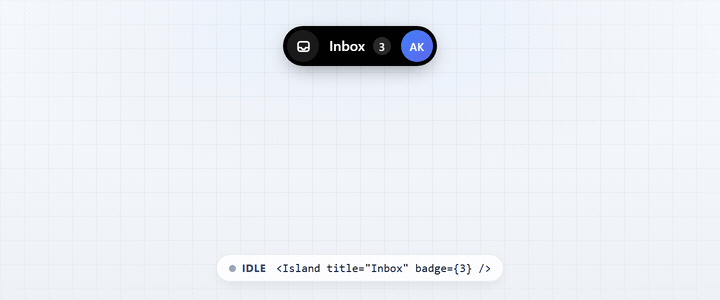
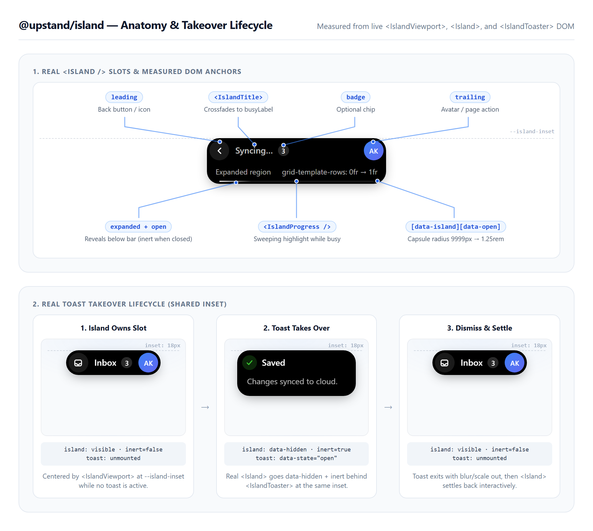
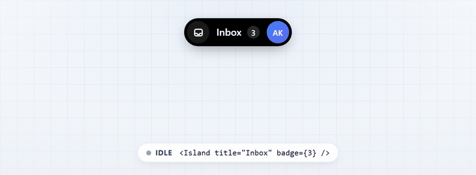
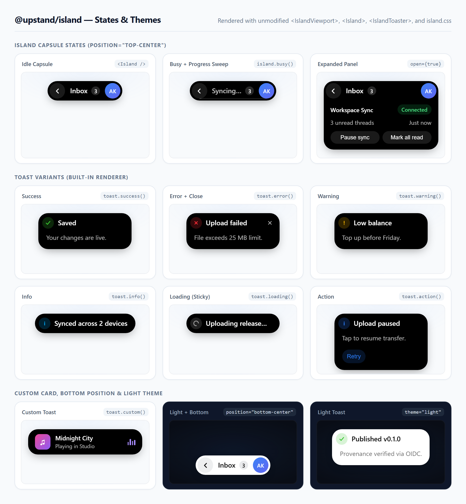

# @upstand/island

[](https://www.npmjs.com/package/@upstand/island)
[](https://github.com/UpstandPlatform/island/actions/workflows/ci.yml)
[](https://github.com/UpstandPlatform/island/blob/main/LICENSE)

A dynamic-island header for React. One black capsule shows where you are, sweeps a bar while background work runs, expands for inline panels, and turns into your toasts: a toast opens right where the island sits, and the island stretches and fades into it, then settles back when the toast leaves.

<p align="center">
  
</p>

- **Layered.** A framework-free core (busy activity, toast queue, slots, events), React bindings, and an optional stylesheet.
- **Headless.** `<Island>` renders structure and `data-*` state. Use the bundled CSS or style it yourself.
- **Pluggable renderer.** A built-in toast renderer, or [sileo](https://github.com/hiaaryan/sileo) through an engine adapter (optional peer).
- **SSR safe.** `useSyncExternalStore` with a stable server snapshot, and nothing touches `window` at import.
- **No strings inside.** Every label comes from you, so it works in any language. RTL and reduced motion are supported.
- **Accessible.** Polite or assertive announcements, it never moves focus, and the hidden island (along with collapsed `expanded` panels) is `inert`.

## Installation

```sh
npm install @upstand/island
# or
pnpm add @upstand/island
# or
bun add @upstand/island

# optional, for the sileo engine
npm install sileo
```

## Quick start

```tsx
import { IslandProvider, Island, IslandToaster, island } from "@upstand/island";
import "@upstand/island/island.css";

export function App() {
  return (
    <IslandProvider>
      <header style={{ position: "fixed", top: 8, insetInline: 0, display: "flex", justifyContent: "center" }}>
        <Island title="Inbox" trailing={<Avatar />} />
      </header>
      <IslandToaster inset="8px" />
      <Page />
    </IslandProvider>
  );
}

function SaveButton() {
  return <button onClick={() => island.toast.success("Saved", { description: "Your changes are live." })}>Save</button>;
}
```

With Tailwind v4, import the stylesheet into a layer so your utilities override it:

```css
@import "@upstand/island/island.css" layer(components);
```

## How It Works

The island shares a single fixed surface (`--island-inset` from the viewport edge) coordinated by a framework-free store:

1. **Single-capsule takeover.** `<Island>` sits inside your header or `<IslandViewport>` (`z-index: 40`). When a toast becomes active, `<Island>` applies `data-hidden`, `aria-hidden="true"`, and `inert`, stretching (`scale(1.12, 0.96)`) and blurring out while `<IslandToaster>` (`z-index: 50`) opens directly at the matching `inset`. When the toast dismisses, `<Island>` settles back interactively.
2. **Ref-counted busy stack.** Every `island.busy(label)` call pushes a token onto an active map and returns an idempotent `done()` callback. Multiple concurrent tasks stack cleanly: the newest labelled registration owns the crossfaded `<IslandTitle>` and sweeping `<IslandProgress />` highlight, falling back to earlier active labels as tasks complete.
3. **Mounted slot stack.** Route or view components publish contextual header props with `useIslandSlot(key, value)`. The most recently mounted publisher wins, and releasing/unmounting restores the previous publisher automatically.
4. **Store-owned toast lifecycle.** The store handles ids, per-type timers, `replace`/`queue` strategies, hover/focus pause-and-resume, promise settling, and haptic callbacks—while engines (`DefaultIslandToastEngine` or `sileoEngine`) only render the active toast and report user dismissals back.

<p align="center">
  
</p>

## States & Animations

### Ref-counted busy activity & expandable panels

`island.busy()` crossfades the title to the newest active task and activates the bottom sweep bar; `<Island expanded={...} open />` smoothly expands both width and height (`grid-template-rows` / `grid-template-columns: 0fr → 1fr`) while morphing the capsule radius.

<p align="center">
  
</p>

### In-place toast morphing & takeover

Toasts open directly over the island's `inset`, update in place (such as `loading` → `success` with expanded description), or morph seamlessly under the `replace` strategy before blurring back into the resting capsule.

<p align="center">
  
</p>

### All states & themes overview

<p align="center">
  
</p>

## Imperative API

`island` works anywhere: event handlers, query callbacks, plain modules. It is bound to the shared store, the same one `<IslandProvider>` uses when you don't give it a `store`. For code that must not import React, use `islandCore` from `@upstand/island/core`.

```ts
island.toast.success("Saved");                          // title only
island.toast.error("Upload failed", { description: "File is too large" });
island.toast.warning({ title: "Heads up", description: "Low balance", duration: 10_000 });
island.toast.info("Synced");
const id = island.toast.loading("Uploading…");          // sticky until updated or dismissed
island.toast.update(id, { type: "success", title: "Uploaded" });
island.toast.action("Something went wrong", { action: { label: "Retry", onClick: retry } });
island.toast.custom(<MyCard />, { duration: null });
island.toast.dismiss(id);                               // one toast
island.toast.dismiss();                                 // all toasts

await island.toast.promise(save(), {
  loading: "Saving",
  success: (result) => ({ title: "Saved", description: result.name }),
  error: (err) => ({ title: "Couldn't save", description: String(err) }),
});

const done = island.busy("Loading older messages");     // ref-counted
done();                                                 // idempotent
```

Every toast function takes `(title, options?)` or `(options)` and returns the toast id. `toast.custom(content, options?)` renders `content` directly inside `[data-island-toast-custom]` without an empty header or icon circle unless `title` or `icon` is provided.

| Option | Type | |
| --- | --- | --- |
| `id` | `string` | Reusing an id that is up updates that toast in place. |
| `title` | `string` | |
| `description` | `ReactNode` | |
| `duration` | `number \| null` | In ms. `null` keeps the toast until it is dismissed. Defaults to 6000, and `loading` is sticky. |
| `action` | `{ label, onClick, dismiss? }` | A button. It dismisses the toast unless `dismiss: false`. |
| `icon` | `ReactNode` | Replaces the type icon. |
| `content` | `ReactNode` | Body for `custom` toasts. |
| `important` | `boolean` | Announce assertively. This is the default for errors. |
| `dismissible` | `boolean` | Allows swipe and close dismissal. Default `true`. |
| `data` | `Record<string, unknown>` | Free-form data for custom engines. |
| `onDismiss` | `(toast, reason) => void` | `reason` is one of `timeout`, `user`, `swipe`, `replaced`, `overflow`, `api`. |

`promise` resolves or rejects with the original value. If another toast replaced the loading toast in the meantime, the result is still shown. If the user dismissed it, the result is dropped.

## React

### `<IslandProvider>`

| Prop | Default | |
| --- | --- | --- |
| `store` | shared store | Use your own store from `createIslandStore()`, e.g. in tests. |
| `strategy` | `"replace"` | `"replace"` makes a new toast morph the current one. `"queue"` makes toasts wait their turn. |
| `maxQueue` | `3` | Maximum number of waiting toasts. The oldest waiting one is dropped first. |
| `durations` | `{}` | Default duration per type, e.g. `{ error: 10_000 }`. |
| `onHaptic` | | `(kind: "success" \| "error" \| "warning" \| "light" \| "selection") => void`. |

Wiring haptics to Telegram Mini Apps:

```tsx
<IslandProvider
  onHaptic={(kind) => {
    const haptics = window.Telegram?.WebApp?.HapticFeedback;
    if (kind === "light") haptics?.impactOccurred("light");
    else if (kind === "selection") haptics?.selectionChanged();
    else haptics?.notificationOccurred(kind);
  }}
/>
```

### `<Island>`

A headless capsule with slots. It hides itself (`data-hidden`, `aria-hidden`, `inert`) while a toast owns the island.

| Prop | |
| --- | --- |
| `leading` / `trailing` | Start and end slots, such as a back button, an avatar or an action. |
| `title` | Crossfades to the newest busy label while the island is busy. |
| `badge` | Chip after the title. |
| `children` | Replaces the title and badge region, e.g. to wrap them in a link. Put `<IslandTitle>` inside. |
| `progress` | `"auto"` (default), `true` or `false`. Controls the sweeping bar shown while busy. |
| `expanded` + `open` | Content revealed below the bar. The island grows to fit it and keeps collapsed panels `inert`. |
| `hideOnToast` | Default `true`. |
| `busyFallbackLabel` | Screen-reader text while the island is busy without a label. |

Parts: `<IslandTitle>`, `<IslandProgress>`, and `<IslandViewport position inset>`, a fixed, centred container for apps without a header.

```tsx
<Island leading={<BackButton />} trailing={<ProfileLink />}>
  <a href="/settings">
    <IslandTitle className="title">{title}</IslandTitle>
    {unread > 0 && <span className="count">{unread}</span>}
  </a>
</Island>
```

### `<IslandToaster>`

Render it once.

| Prop | Default | |
| --- | --- | --- |
| `engine` | built-in | Renderer. See [Engines](#engines). |
| `position` | `"top-center"` | Or `"bottom-center"`. |
| `inset` | `calc(env(safe-area-inset-top \| bottom, 0px) + 0.5rem)` | Distance from the matching viewport edge (`top` or `bottom`) to the island's edge. Match it to your island so the toast opens on top of it. |
| `swipeToDismiss` | `true` | Swipe toward the edge to dismiss. |
| `closeLabel` | | Accessible label for a close button. No button is shown without it. |

In a fullscreen Telegram Mini App, centre the island in Telegram's content safe area (the row holding its buttons) and pass the same math:

```tsx
<IslandToaster inset="calc(var(--tg-safe-area-inset-top, 0px) + (var(--tg-content-safe-area-inset-top, 0px) - var(--island-height)) / 2)" />
```

Hovering or focusing a toast pauses its timer. Pressing Escape dismisses a focused toast.

### Hooks

| Hook | |
| --- | --- |
| `useIsland(selector?)` | Subscribes to `IslandState` (`busy`, `busyCount`, `busyLabel`, `toast`, `queue`, `slots`). Selectors must return stable values. |
| `useIslandApi()` | The imperative API bound to the store in context. |
| `useIslandBusy(active, label?)` | Keeps the island busy while `active` is true, e.g. `useIslandBusy(isFetchingNextPage, "Loading more")`. |
| `useIslandActivity()` | `{ busy, label }` |
| `useIslandToastActive()` | `true` while a toast owns the island. |
| `useIslandSlot(key, value)` | Publishes a typed value while the component is mounted. The newest publisher wins, and the previous value comes back when it unmounts. `null` publishes nothing. |
| `useIslandSlotValue<T>(key)` | Reads a slot. |

```tsx
// A page publishes, the header reads.
function ChatPage({ chat }) {
  useIslandSlot("title", chat.name);
  useIslandSlot<ChatAvatar>("avatar", chat.avatar);
}
function Header() {
  const title = useIslandSlotValue<string>("title") ?? "Home";
  const avatar = useIslandSlotValue<ChatAvatar>("avatar");
  return <Island leading={avatar && <Avatar {...avatar} />} title={title} />;
}
```

## Engines

The store owns every toast's lifecycle: ids, timers, the queue, pausing and haptics. An engine only draws the current toast and reports dismissals back to the store.

```tsx
import { createSileoEngine, sileoEngine } from "@upstand/island/sileo";

<IslandToaster engine={sileoEngine} />
<IslandToaster engine={createSileoEngine({ theme: "dark", fill: "#000000", styles: { description: "opacity-70" } })} />
```

The sileo engine routes every toast through a single sileo slot, so a new toast morphs the current one instead of stacking. It also sets `--sileo-height` to `--island-height` and offsets sileo's viewport padding, so the toast lands exactly on the island.

To write your own engine, take `IslandToastEngineProps` (`toast`, `store`, `position`, `inset`, `swipeToDismiss`, `closeLabel`). Call `store.dismiss(id, "user" | "swipe")` and `store.pause()` / `store.resume()` as the user interacts. Set `Engine.announces` to `"polite"` or `"all"` if your renderer already makes its own announcements.

## Core (no React)

```ts
import { createIslandStore, createIslandApi } from "@upstand/island/core";

const store = createIslandStore({ strategy: "queue", maxQueue: 5 });
const api = createIslandApi(() => store);
store.subscribe(() => console.log(store.getSnapshot()));
store.on("dismiss", (toast, reason) => analytics.track("toast", { reason }));
```

Events: `show`, `update`, `dismiss`, `busy` and `change`. `getServerSnapshot()` always returns the same frozen empty state.

## Styling

`island.css` uses `:where()` throughout, so its rules have zero specificity. Theme it with custom properties:

| Variable | Default |
| --- | --- |
| `--island-bg` / `--island-fg` | `#000` / `#fff` |
| `--island-height` | `40px` |
| `--island-max-width` | `min(20rem, calc(100vw - 2rem))` |
| `--island-radius` / `--island-radius-expanded` | `9999px` / `1.25rem` |
| `--island-ease` / `--island-duration` | `cubic-bezier(0.22, 1, 0.36, 1)` / `420ms` |
| `--island-inset` | `calc(env(safe-area-inset-top \| bottom, 0px) + 0.5rem)` |
| `--island-success`, `-error`, `-warning`, `-info`, `-loading`, `-action` | state colours |

Set `data-island-theme="light"` or `data-island-theme="system"` on any ancestor to switch palettes. Under `prefers-reduced-motion`, the morph, the label slide and the sweep are replaced by a steady, dimmed bar. The progress sweep reverses in `dir="rtl"`.

State attributes you can target: `[data-island][data-hidden]`, `[data-busy]`, `[data-open]`, `[data-island-toast][data-type][data-state="open"|"closed"]`, `[data-island-toast-custom]`.

## License

MIT
