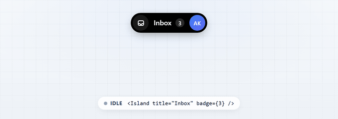
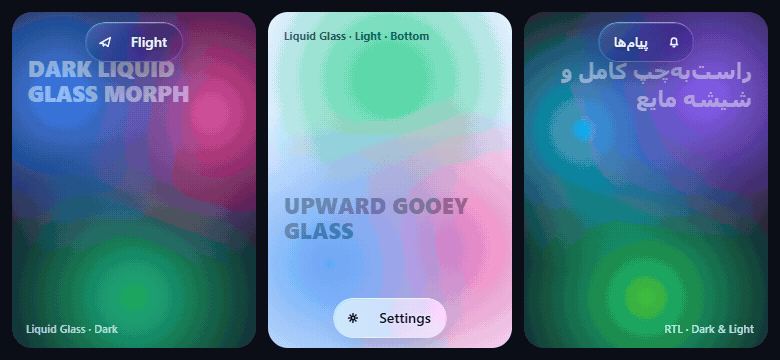
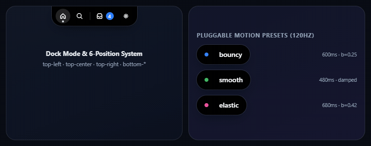

# @upstand/island

[](https://www.npmjs.com/package/@upstand/island)
[](https://github.com/UpstandPlatform/island/actions/workflows/ci.yml)
[](https://github.com/UpstandPlatform/island/blob/main/LICENSE)

A customizable, zero-dependency dynamic island, dock, and gooey toast system for React. One surface anchors to any of 6 viewport positions, morphs smoothly at **120Hz** via **pluggable spring/easing physics**, switches live between **Solid** and **Liquid Glass** materials, adapts natively to **RTL**, and turns seamlessly into rich gooey notifications.

<p align="center">
  
</p>

- **Zero dependencies & layered architecture.** Framework-free core (`@upstand/island/core`), pluggable 120Hz motion engine (`@upstand/island/motion`), headless React primitives (`@upstand/island`), optional stylesheet (`@upstand/island/island.css`), and optional [sileo](https://github.com/hiaaryan/sileo) engine adapter (`@upstand/island/sileo`).
- **120Hz physics & pluggable motion adapters.** Exact analytical spring solver (`60Hz` / `120Hz` / `240Hz+`) with 6 presets (`bouncy`, `smooth`, `snappy`, `elastic`, `gentle`, `instant`) plus `createSpringMotion`, `createEasingMotion`, `createCssMotion`, and the open `IslandMotionAdapter` interface.
- **Solid & live Liquid Glass.** Switch globally, per component, or per toast between crisp `solid` capsules and GPU-accelerated refractive `liquid-glass` surfaces with Fresnel bevel, chromatic edge dispersion, specular rim, and dark/light/system themes.
- **6-position system & Dock mode.** Anchor to `top-left`, `top-center`, `top-right`, `bottom-left`, `bottom-center`, or `bottom-right` (with automatic upward expansion from the bottom), and switch between `"floating"` capsules and edge-attached `"dock"` bars with `<IslandDock>`, `<IslandDockItem>`, and `<IslandDockDivider>`.
- **Full RTL & viewport-safe expansion.** `dir="auto" | "ltr" | "rtl"` watches ancestor `[dir]` live, mirrors headers/progress sweeps, and keeps `[data-island-anchor]` pinned so top/bottom expanded panels never go off-screen.
- **SSR safe & accessible.** Stable `getServerSnapshot()`, zero `window` access on import, polite/assertive live regions, reduced-motion fallbacks, and `inert` isolation when hidden or collapsed.

## Installation

```sh
npm install @upstand/island
# or
pnpm add @upstand/island
# or
bun add @upstand/island

# optional, only needed for @upstand/island/sileo
npm install sileo
```

## Quick start

```tsx
import { IslandProvider, Island, IslandViewport, IslandToaster, island } from "@upstand/island";
import "@upstand/island/island.css";

export function App() {
  return (
    <IslandProvider position="top-center" surface="solid" motion="bouncy" theme="dark" dir="auto">
      <IslandViewport>
        <Island
          leading={<InboxIcon />}
          title="Inbox"
          badge={<Badge>3</Badge>}
          trailing={<Avatar />}
        />
      </IslandViewport>
      <IslandToaster />
      <Page />
    </IslandProvider>
  );
}

function SaveButton() {
  return (
    <button
      onClick={() =>
        island.toast.success("Saved", {
          description: "Your changes are live everywhere.",
          surface: "liquid-glass",
        })
      }
    >
      Save
    </button>
  );
}
```

With Tailwind v4, import the stylesheet into a layer so your utility classes override it:

```css
@import "@upstand/island/island.css" layer(components);
```

## Architecture & Anatomy

The island coordinates all resting bars, docks, busy indicators, expanded drawers, and morphing toasts around a shared store and aligned viewport coordinates:

1. **Single-capsule takeover & viewport-safe anchoring.** `<Island>` mounts inside `[data-island-anchor]`, pinning the bar height at the header/footer edge so `top-*` expands strictly downward and `bottom-*` expands strictly upward (clamped cleanly to available viewport height with internal scrolling). When a toast opens, `<Island>` sets `data-hidden`, `aria-hidden="true"`, and `inert` while `<IslandToaster>` morphs at the exact same anchor.
2. **Analytic C1 gooey geometry.** `DefaultIslandToastEngine` renders C1-continuous cubic Bezier shoulders (`buildGooeyPath` + `computePillX`) driven at the display refresh rate via direct DOM/SVG updates (`useMotionController`), supporting fade/slide crossfade headers, autopilot expand/collapse, collapse-before-swap transitions, and velocity-tracked swipe-to-dismiss with spring return.
3. **Ref-counted busy & slot stacks.** Concurrent `island.busy(label)` calls and `useIslandSlot(key, value)` registrations follow last-in-first-out ownership, restoring earlier labels or slot values automatically on completion/unmount.

<p align="center">
  
</p>

## Visual Showcase

### Ref-counted busy sweep & spring-shaped expandable drawer

`island.busy()` crossfades stacked task labels and sweeps `<IslandProgress />`; `<Island expanded={...} open autoMorph />` animates its width and height through spring-shaped CSS grid tracks, avoiding competing size measurements during repeated open/close. Islands without an expanded panel use configurable spring physics to morph intrinsic content changes. Leading and trailing slots stay fixed under flex pressure.

<p align="center">
  
</p>

### Analytic C1 gooey morph & collapse-before-swap

`island.toast.promise()` and sequential notifications morph smoothly between compact header pills and expanded action drawers using C1-continuous shoulders and fade/slide-crossfade titles.

<p align="center">
  
</p>

### Live Liquid Glass, upward bottom morph & full RTL

Switch live between `surface="solid"` and `surface="liquid-glass"`, `theme="dark" | "light" | "system"`, `bottom-*` upward expansion, and full `dir="rtl"` mirroring.

<p align="center">
  
</p>

### Dock mode, 6-position anchoring & pluggable physics

Combine `mode="dock"`, the composable `<IslandDock>` bar primitives, live position switching across all 6 viewport spots, and side-by-side 120Hz motion adapters (`bouncy`, `smooth`, `elastic`).

<p align="center">
  
</p>

### Complete states & themes matrix

<p align="center">
  
</p>

## Pluggable 120Hz Motion & Physics

Import presets or factories from `@upstand/island` or the tree-shakeable subpath `@upstand/island/motion`:

| Preset (`ISLAND_MOTIONS`) | Feel | Underlying driver |
| --- | --- | --- |
| `"bouncy"` *(default)* | Crisp spring overshoot (`340–360ms`, `bounce: 0.2`) | Analytical spring |
| `"smooth"` | Critically damped zero-overshoot glide (`260–300ms`) | Analytical spring |
| `"snappy"` | Fast interactive response (`230–250ms`, `bounce: 0.14`) | Analytical spring |
| `"elastic"` | Expressive tactile bounce (`400–420ms`, `bounce: 0.32`) | Analytical spring |
| `"gentle"` | Relaxed drawer settle (`380–400ms`, `bounce: 0.05`) | Analytical spring |
| `"instant"` | Zero-motion snap (also used when `prefers-reduced-motion` matches) | Immediate |

Create tuned presets or plug in your own adapter (`IslandMotionAdapter`) backed by `requestAnimationFrame`, Web Animations API, Framer Motion, or GSAP:

```tsx
import {
  IslandProvider,
  createSpringMotion,
  createEasingMotion,
  createCssMotion,
  easings,
  type IslandMotionAdapter,
} from "@upstand/island/motion";

// 1. Custom spring tuning per animation channel
const customSpring = createSpringMotion({
  name: "brand-spring",
  default: { duration: 540, bounce: 0.3 },
  channels: {
    expand: { duration: 620, bounce: 0.24 },
    collapse: { duration: 420, bounce: 0.1 },
    dragReturn: { stiffness: 380, damping: 24 },
  },
});

// 2. Time-based easing adapter
const silkyEase = createEasingMotion({ duration: 440, easing: easings.easeOutExpo });

// 3. CSS transition token adapter (drives --island-duration / --island-ease)
const cssMotion = createCssMotion({ duration: "360ms", easing: "cubic-bezier(0.22, 1, 0.36, 1)" });

// 4. Fully custom pluggable adapter
const myAdapter: IslandMotionAdapter = {
  name: "linear-120hz",
  animate({ from, to, onUpdate, onComplete }) {
    let raf = 0;
    const start = performance.now();
    const tick = (now: number) => {
      const t = Math.min(1, (now - start) / 300);
      onUpdate(from + (to - from) * t, 0);
      if (t < 1) raf = requestAnimationFrame(tick);
      else onComplete();
    };
    raf = requestAnimationFrame(tick);
    return { stop: () => cancelAnimationFrame(raf) };
  },
};

<IslandProvider motion={customSpring}>{/* ... */}</IslandProvider>
```

## Live Liquid Glass & Solid Surfaces

Choose `surface="solid"` (default) or `surface="liquid-glass"` on `<IslandProvider>`, `<Island>`, `<IslandToaster>`, or individual toasts, and fine-tune optical properties via `glass` (`IslandGlassOptions`):

```tsx
<IslandProvider
  surface="liquid-glass"
  theme="system" // "dark" | "light" | "system"
  roundness={18}
  glass={{
    blur: 14,         // px backdrop blur (default ~11-12px)
    saturation: 1.9,  // backdrop color saturation (default 1.8-1.85)
    refraction: 1.15, // inner Fresnel bevel strength
    dispersion: 0.75, // chromatic edge prism tint
    specular: 1,      // glass specular rim highlight
    lite: false,      // true disables the chromatic prism layer on lower-end GPUs
  }}
>
```

The reusable `<IslandGlassBackdrop>` component is also exported if you build custom toast engines or floating chrome matching `@upstand/island`'s optical surface.

## 6-Position System & Dock Mode

All 6 anchor positions are supported by `IslandProvider`, `Island`, `IslandViewport`, `IslandToaster`, `island.setPosition()`, and per-toast `position`:

- `"top-left"`, `"top-center"`, `"top-right"` — pin cleanly below the top edge and expand **downward**.
- `"bottom-left"`, `"bottom-center"`, `"bottom-right"` — pin cleanly above the bottom edge and expand **upward**.

Switch `mode` between `"floating"` (pill capsule with edge inset) and `"dock"` (flush viewport-edge notch/bar with safe-area padding), and optionally compose navigation actions with `<IslandDock>`, `<IslandDockItem>`, and `<IslandDockDivider>`:

```tsx
<IslandProvider position="bottom-center" mode="dock" surface="liquid-glass">
  <IslandViewport>
    <Island>
      <IslandDock aria-label="Primary dock">
        <IslandDockItem icon={<HomeIcon />} label="Home" active onClick={() => go("/")} />
        <IslandDockItem icon={<SearchIcon />} label="Search" showLabel onClick={openSearch} />
        <IslandDockDivider />
        <IslandDockItem icon={<InboxIcon />} label="Inbox" badge={4} onClick={() => go("/inbox")} />
        <IslandDockItem icon={<BellIcon />} label="Alerts" badge /> {/* unread dot */}
      </IslandDock>
    </Island>
  </IslandViewport>
  <IslandToaster />
</IslandProvider>
```

## Full RTL Support

Set `dir="auto"` (default, observes `<html dir>` / ancestor `[dir]` attributes live via `MutationObserver`), `"ltr"`, or `"rtl"`. Horizontal slot padding, progress sweeps, header truncation, close/action controls, and pill corner flow automatically adapt to reading direction, while viewport edge anchors (`*-left` / `*-right`) preserve physical screen coordinates so overlays stay where you placed them.

## Imperative API

`island` works everywhere (event handlers, query callbacks, non-React modules) and drives the default shared store (or import `islandCore` from `@upstand/island/core` when React must not be imported):

```ts
island.toast.success("Saved");
island.toast.error("Upload failed", { description: "File exceeds 25 MB." });
island.toast.warning({ title: "Heads up", description: "Low storage.", duration: 10_000 });
island.toast.info("Synced");

const id = island.toast.loading("Uploading…"); // sticky until updated or dismissed
island.toast.update(id, { type: "success", title: "Uploaded", autopilot: { expand: 120, collapse: 4000 } });

island.toast.action("Webhook paused", { action: { label: "Retry", onClick: retry } });
island.toast.custom(<MyCard />, { duration: null });
island.toast.dismiss(id);
island.toast.dismiss();

await island.toast.promise(save(), {
  loading: "Saving",
  success: (res) => ({ title: "Saved", description: res.name }),
  error: (err) => ({ title: "Couldn't save", description: String(err) }),
});

const done = island.busy("Syncing workspace…"); // ref-counted
done();                                        // idempotent

// Live layout mutators
island.setPosition("bottom-right");
island.setMode("dock");
island.setSurface("liquid-glass");
island.setDir("rtl");
island.setTheme("light");
```

### Toast Options

| Option | Type | Description |
| --- | --- | --- |
| `id` | `string` | Reusing an active id updates that toast in place. |
| `title` | `string` | Primary toast label. |
| `description` | `ReactNode` | Expanded detail content. |
| `duration` | `number \| null` | Auto-dismiss delay in ms (`null` = sticky). Defaults to `6000` (`loading` defaults sticky). |
| `action` | `{ label, onClick, dismiss? }` | Interactive pill CTA (`dismiss: false` keeps the toast open). |
| `icon` | `ReactNode` | Overrides the default semantic icon. |
| `content` | `ReactNode` | Custom card content (standalone card when `title`/`icon` omitted). |
| `position` | `IslandPosition` | Override toast anchor across any of the 6 positions. |
| `surface` | `IslandSurface` | `"solid"` or `"liquid-glass"` override for this toast. |
| `glass` | `IslandGlassOptions` | Custom optical glass tuning for this toast. |
| `roundness` | `number` | Gooey shoulder & corner roundness in px (default `16`). |
| `autopilot` | `boolean \| { expand?, collapse? }` | Timed auto-expand and auto-collapse delays in ms. |
| `motion` | `IslandMotionInput` | Per-toast motion preset or adapter override. |
| `fill` | `string` | Custom solid background fill color for this toast. |
| `styles` | `IslandToastStyles` | Class overrides (`root`, `header`, `icon`, `title`, `body`, `description`, `action`, `close`). |
| `important` | `boolean` | Assertive live announcement (default for `"error"`). |
| `dismissible` | `boolean` | Enables close button & swipe-to-dismiss. Default `true`. |
| `data` | `Record<string, unknown>` | Arbitrary payload passed through to custom engines. |
| `onDismiss` | `(toast, reason) => void` | `reason`: `"timeout" \| "user" \| "swipe" \| "replaced" \| "overflow" \| "api"`. |

## React Reference

### `<IslandProvider>`

| Prop | Default | Description |
| --- | --- | --- |
| `store` | shared store | Provide an isolated store from `createIslandStore()`. |
| `strategy` | `"replace"` | `"replace"` morphs active toast; `"queue"` queues toasts sequentially. |
| `maxQueue` | `3` | Maximum waiting toasts under `"queue"`. |
| `durations` | `{}` | Default durations per `IslandToastType`. |
| `onHaptic` | | `(kind: "success" \| "error" \| "warning" \| "light" \| "selection") => void`. |
| `position` | `"top-center"` | Global anchor (`top-left`, `top-center`, `top-right`, `bottom-left`, `bottom-center`, `bottom-right`). |
| `mode` | `"floating"` | `"floating"` capsule or `"dock"` bar. |
| `surface` | `"solid"` | `"solid"` or `"liquid-glass"`. |
| `glass` | | Default `IslandGlassOptions`. |
| `motion` | `"bouncy"` | `IslandMotionPreset` or custom `IslandMotionAdapter`. |
| `dir` | `"auto"` | `"ltr"`, `"rtl"`, or `"auto"`. |
| `theme` | *(inherits)* | `"dark"`, `"light"`, or `"system"`. |
| `roundness` | `16` | Default corner/shoulder roundness in px. |
| `autopilot` | `true` | Global toast expand/collapse timing policy. |
| `icons` | | Custom `IslandToastIcons` (`success`, `error`, `warning`, `info`, `loading`, `action`). |
| `styles` | | Global `IslandToastStyles` class overrides. |

### `<Island>` & `<IslandViewport>`

`<Island>` renders `[data-island-anchor]` containing `[data-island]`, automatically wrapping present `leading`, `trailing`, and `badge` slots in non-shrinking `[data-island-leading]`, `[data-island-trailing]`, and `[data-island-badge]` wrappers. `<IslandViewport>` is a zero-boilerplate fixed portal-free container aligned across all 6 positions.

| `<Island>` Prop | Description |
| --- | --- |
| `leading` / `trailing` | Start and end slots (back button, avatar, status button). Never flex-shrink when the title is long. |
| `title` | Crossfades to the newest `island.busy(label)` text while busy. |
| `badge` | Non-shrinking chip placed after `title` inside `[data-island-body]`. |
| `children` | Replaces `[data-island-body]` when customizing the middle region (use `<IslandTitle>` inside). |
| `progress` | `"auto"` *(default)*, `true`, or `false` for the sweeping busy bar. |
| `expanded` + `open` | Content expanded downward (`top-*`) or upward (`bottom-*`), viewport-clamped and `inert` when closed. |
| `hideOnToast` | Default `true`. Fades and marks `<Island>` `inert` while a toast takes over. |
| `busyFallbackLabel` | Screen-reader status text used when busy without a label. |
| `position`, `mode`, `surface`, `glass`, `motion`, `dir`, `theme`, `roundness` | Optional per-component overrides over provider/store layout state. |
| `autoMorph` | Default `true`. Enables native-refresh-rate width/height morphing for intrinsic content changes when no expanded panel is present. With an expanded panel, CSS grid tracks animate both dimensions so intermediate frames cannot feed back into the size spring. |

### `<IslandToaster>`

Render `<IslandToaster />` once inside `<IslandProvider>`.

| Prop | Default | Description |
| --- | --- | --- |
| `engine` | `DefaultIslandToastEngine` | Built-in 120Hz C1 gooey renderer or custom `IslandToastEngine` (`sileoEngine`). |
| `position`, `mode`, `surface`, `glass`, `motion`, `dir`, `theme`, `roundness` | *(inherits)* | Optional overrides for notifications. |
| `inset` | `0px` (dock) / `calc(safe-area + 0.5rem)` | Distance from vertical viewport edge (`top` / `bottom`). |
| `insetX` | `calc(safe-area + 0.75rem)` | Distance from horizontal edge for `*-left` and `*-right`. |
| `autopilot` | `true` | Auto-expand/collapse timing. |
| `swipeToDismiss` | `true` | Velocity-tracked edge swipe dismissal with spring snap-back. |
| `closeLabel` | | Renders a dismiss button with this `aria-label` when provided. |
| `icons` / `styles` | | Custom icon & class-name overrides merged cleanly with per-toast options. |

### Hooks

| Hook | Returns / Purpose |
| --- | --- |
| `useIsland(selector?)` | Subscribes to `IslandState` (`busy`, `busyCount`, `busyLabel`, `toast`, `queue`, `slots`, layout fields). |
| `useIslandApi()` | Imperative `island` API bound to the store in context. |
| `useIslandBusy(active, label?)` | Keeps the island busy while `active` is `true`. |
| `useIslandActivity()` | `{ busy, label }`. |
| `useIslandToastActive()` | `true` while a toast owns the island. |
| `useIslandSlot(key, value)` | Scoped LIFO slot registration while mounted. |
| `useIslandSlotValue<T>(key)` | Subscribes to a registered slot value. |
| `useIslandConfig()` | Active provider layout & theme configuration. |
| `useIslandPosition()` | `[position, setPosition]` stateful tuple backed by the store. |
| `useIslandMode()` | `[mode, setMode]` stateful tuple (`"floating" \| "dock"`). |
| `useIslandSurface()` | `[surface, setSurface]` stateful tuple (`"solid" \| "liquid-glass"`). |
| `useIslandDirection()` | Resolved `"ltr" \| "rtl"` after `auto` detection. |
| `useIslandMotion(override?)` | Resolved `IslandMotionAdapter` respecting `prefers-reduced-motion`. |

## Engines (`@upstand/island/sileo`)

Use the built-in `DefaultIslandToastEngine` out of the box, or plug in `sileoEngine` / `createSileoEngine` (`sileo` optional peer dependency) across all 6 viewport positions, RTL, dark/light/system themes, roundness, and autopilot:

```tsx
import { createSileoEngine, sileoEngine } from "@upstand/island/sileo";

<IslandToaster engine={sileoEngine} />
<IslandToaster
  engine={createSileoEngine({
    theme: "dark",
    roundness: 16,
    autopilot: true,
    styles: { description: "opacity-75" },
  })}
/>
```

To build a custom engine, accept `IslandToastEngineProps`, render `toast`, report dismissals via `store.dismiss(id, "user" | "swipe")`, call `store.pause()` / `store.resume()`, and optionally set `Engine.announces` (`"polite"` | `"all"`).

## Core (`@upstand/island/core`)

Use the framework-free state machine anywhere outside React:

```ts
import { createIslandStore, createIslandApi } from "@upstand/island/core";

const store = createIslandStore({
  strategy: "queue",
  maxQueue: 5,
  position: "top-right",
  surface: "liquid-glass",
  dir: "auto",
});

const api = createIslandApi(() => store);
store.on("dismiss", (toast, reason) => analytics.track("toast", { reason }));
store.on("layout", (layout) => console.log("layout updated:", layout));
```

Events: `show`, `update`, `dismiss`, `busy`, `layout`, and `change`. `getServerSnapshot()` returns a frozen empty snapshot matching initial store layout overrides for SSR hydration safety.

## Styling & Customization

Most `island.css` selectors use `:where(...)` (zero specificity), so utility classes and custom CSS can take precedence. Reset classes on native dock and toast buttons keep broad page-level `button` rules from distorting those controls. Switch palettes by passing `theme` or setting `data-island-theme="light" | "dark" | "system"` on any ancestor.

| CSS Custom Property | Default | Purpose |
| --- | --- | --- |
| `--island-bg` / `--island-fg` | `#000` / `#fff` | Solid surface background & text (`#fff` / `#0a0a0a` in light theme) |
| `--island-height` | `40px` | Resting bar height & pill endcap diameter |
| `--island-max-width` / `--island-max-height` | `min(22rem, calc(100vw - 1.5rem))` / viewport clamp | Island capsule bounds & expanded scroll clamp |
| `--island-radius` / `--island-radius-expanded` | `calc(var(--island-height) / 2)` / `1.25rem` | Resting pill & expanded panel corner radius |
| `--island-roundness` | `16px` | Analytic gooey corner & neck curve roundness |
| `--island-inset` / `--island-inset-x` | safe-area + `0.5rem` / safe-area + `0.75rem` | Vertical and horizontal viewport spacing |
| `--island-duration` / `--island-ease` | `300ms` / `cubic-bezier(0.22, 1, 0.36, 1)` | CSS fallback motion timing tokens |
| `--island-expand-duration` / `--island-collapse-duration` | inherit `--island-duration` | Expanded-panel open and close timing |
| `--island-glass-blur` / `--island-glass-saturation` | `11px` / `1.85` | Live Liquid Glass backdrop blur & color boost |
| `--island-glass-tint` / `--island-glass-rim` | adaptive dark/light glass tokens | Optical glass tint & Fresnel highlight rim |
| `--island-success`, `-error`, `-warning`, `-info`, `-loading`, `-action` | semantic oklch tokens | Accent colors for icons, badges, and buttons |

Targetable data attributes:

- `[data-island-anchor][data-position][data-mode][data-open][data-hidden][data-dir]`
- `[data-island][data-position][data-mode][data-surface][data-motion][data-auto-morph][data-dir][data-hidden][data-busy][data-open]`
- `[data-island-leading]`, `[data-island-body]`, `[data-island-title]`, `[data-island-badge]`, `[data-island-trailing]`, `[data-island-expanded]`
- `[data-island-dock]`, `[data-island-dock-item][data-active][data-labeled]`, `[data-island-dock-badge][data-dot]`, `[data-island-dock-divider]`
- `[data-island-viewport][data-position][data-mode][data-dir]`, `[data-island-toaster][data-position][data-mode][data-surface][data-motion][data-dir]`
- `[data-island-toast][data-type][data-surface][data-state="open"|"closed"][data-expanded][data-dragging]`, `[data-island-toast-custom]`, `[data-island-glass-backdrop]`

## License

MIT
